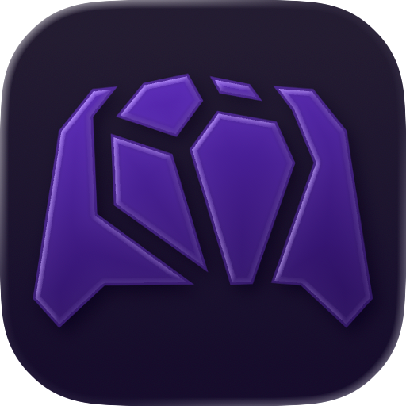

<div align="center">



# Robot Remote

**用藍牙遙控你的 Arduino 自走車與機械手臂**

以 Kotlin + Jetpack Compose 打造的 Android App，透過藍牙遙控中臺機器人研究社的自走車。

<p>
  
  
  
  <a href="LICENSE"></a>
</p>

</div>

---

## 關於

本專案包含 **Android 遙控端 App** 與 **Arduino 自走車韌體**，支援兩種模式：

- **普通自走車**：虛擬搖桿控制前進／後退／原地左右轉，可調速度
- **四軸機械手臂自走車**：除行進外，另可控制底座、大臂、小臂與夾爪四顆舵機

App 會在連線成功、放開搖桿、離開畫面與斷線前自動送出停止指令，確保車輛不會失控。

> 另有以 SwiftUI 開發的 [iOS 版本](https://github.com/robotctust/robot-bluetooth-remote-app-for-ios)。兩個平台由不同負責人開發，功能與實作方式不同。

## 專案結構

```text
├── app/                                 # Android App 原始碼（Kotlin + Jetpack Compose）
│   └── src/main/java/com/robotctust/robotcontroller/
│       ├── MainActivity.kt              # 進入點、藍牙權限、畫面切換
│       ├── bluetooth/BluetoothManager.kt# 藍牙 SPP 連線（含 fallback 重試）與指令送出
│       └── ui/
│           ├── screens/                 # 主選單、自走車、機械手臂控制畫面
│           ├── components/Joystick.kt   # 虛擬搖桿元件
│           └── theme/                   # 配色與字型
├── firmware/
│   ├── bluetooth-remote-control/        # 【模式一】普通自走車 Arduino 韌體
│   └── bluetooth-remote-control-arm/    # 【模式二】機械手臂自走車 Arduino 韌體
├── legacy/
│   └── robot-controller-v3.1.aia        # 舊版 App Inventor 2 專案（v3.1，已停止維護）
├── docs/                                # 圖示等文件素材
├── gradle/ · gradlew · *.gradle.kts     # Gradle 建置設定
└── LICENSE
```

## 硬體需求

- Android 7.0（API 24）以上的裝置
- Arduino Uno / Nano
- L9110S 馬達驅動板
- 藍牙模組：BT06 / HC-06 / HC-05（大部分 SPP 藍牙模組皆可）
- 機械手臂模式另需 4 顆伺服舵機

## 快速開始

### 安裝 App

**方法一：直接安裝 APK**

1. 從 [Releases](https://github.com/robotctust/robot-bluetooth-remote-app/releases) 下載最新的 `.apk`，傳到 Android 手機
2. 點擊安裝（若提示「未知來源應用程式」，請點選允許）

**方法二：用 Android Studio 編譯**

1. 以 **Android Studio**（Ladybug / Koala 或更新版本）**File → Open...** 開啟本專案根目錄
2. 等待 Gradle 同步完成（會自動產生本機的 `local.properties`）
3. 按 **Run** 安裝到手機

- JDK：17 或 21
- Target SDK：API 36（minSdk 24）

### 燒錄韌體

1. 以 Arduino IDE 開啟對應模式的 `.ino`，例如 `firmware/bluetooth-remote-control/bluetooth-remote-control.ino`（同資料夾的 `motor.ino` 會一併編譯）
2. 選擇開發板與序列埠後上傳
3. 可開啟序列埠監控視窗（**115200 bps**）查看收到的藍牙指令，方便除錯

> 機械手臂韌體需要官方 **Servo** 函式庫：Arduino IDE 的 Library Manager 搜尋「Servo」安裝，或執行 `arduino-cli lib install Servo`。

## 硬體接線指南

> [!IMPORTANT]
> **共地原則**：Arduino 的 `GND`、馬達驅動板的 `GND` 以及電池負極**必須全部接在一起**，否則訊號沒有共同參考基準，車輛會無法動作或不受控。

### 1. 馬達驅動板（L9110S）

| 馬達接點 | Arduino 腳位 | 說明 |
| :--- | :--- | :--- |
| **A-1A** | **Pin 5** | 左輪 PWM 速度／前進控制 |
| **A-1B** | **Pin 6** | 左輪方向控制 |
| **B-1A** | **Pin 9** | 右輪 PWM 速度／前進控制 |
| **B-1B** | **Pin 10** | 右輪方向控制 |

左右輪轉速不一致時，可調整 `motor.ino` 中的 `LEFT_MOTOR_PCT` / `RIGHT_MOTOR_PCT` 校正。

### 2. 藍牙模組（BT06 / HC-06 / HC-05）

| 藍牙模組腳位 | Arduino 腳位 | 說明 |
| :--- | :--- | :--- |
| **VCC** | **5V / 3.3V** | 依模組規格供電 |
| **GND** | **GND** | 與系統共地 |
| **TXD** | **Pin 13（BT_RX）** | 藍牙發送 → Arduino 接收 |
| **RXD** | **Pin 12（BT_TX）** | 藍牙接收 → Arduino 發送 |

通訊鮑率為 **9600 bps**。

### 3. 機械手臂舵機（僅機械手臂模式）

| 舵機編號 | 控制部位 | Arduino 腳位 | 預設角度 |
| :--- | :--- | :--- | :--- |
| **1** | 底座旋轉（Base） | **Pin 3** | 90° |
| **2** | 大臂升降（Shoulder） | **Pin 11** | 90° |
| **3** | 小臂伸展（Elbow） | **Pin 8** | 90° |
| **4** | 夾爪開合（Gripper） | **Pin 4** | 90° |

## 藍牙通訊協定

App 與 Arduino 之間透過藍牙 SPP 以純文字傳送控制碼（韌體不分大小寫）。

### 1. 行進方向（單一字元）

| 指令 | 動作 |
| :--- | :--- |
| `F` | 前進 |
| `B` | 後退 |
| `L` | 原地左轉 |
| `R` | 原地右轉 |
| `S` | **停止**（連線成功、放開搖桿時自動送出） |

### 2. 速度（`0`～`9`）

- `0`：停止／煞車（PWM = 0）
- `1`～`9`：速度等級，對應 PWM **100～200**（普通自走車）或 **100～220**（機械手臂車）
- **安全防護**：車輛靜止（`S`）時切換速度不會啟動馬達，必須收到 `F` / `B` / `L` / `R` 後才會動

### 3. 機械手臂舵機（五碼字串）

格式：`M<舵機編號 1-4><三位數角度 000-180>`

- `M1090`：1 號舵機（底座）轉到 90°
- `M4030`：4 號舵機（夾爪）轉到 30°

## 常見問題

**第一次連線找不到自走車？**
新組裝的車輛要先到手機「設定 → 藍牙」完成**首次配對**（預設密碼通常是 `1234` 或 `0000`），之後在 App 點「連線車輛」就會出現在清單中。

**如何讓 App 顯示自訂車名（例如 Robot-Car01）？**
在 [`BluetoothManager.kt`](app/src/main/java/com/robotctust/robotcontroller/bluetooth/BluetoothManager.kt) 的 `KNOWN_CAR_MACS` 加入藍牙模組的 MAC 位址與名稱即可；已登錄的車輛會依車號排在清單最前面。未登錄的裝置會以藍牙模組原始名稱顯示，不影響功能。

**連線後車子會不會突然暴衝？**
不會。連線成功的瞬間 App 會送出停止指令 `S`（並在 100 ms 後再確認一次），韌體開機時也會強制保持靜止，直到使用者推動搖桿才會動作。

## 版本沿革

- **v4.x**（目前）：改以 Kotlin + Jetpack Compose 原生開發，新增機械手臂模式
- **v3.1**：以 [App Inventor 2](https://appinventor.mit.edu/) 開發，原始檔保留於 [`legacy/robot-controller-v3.1.aia`](legacy/robot-controller-v3.1.aia)，可在 AI2 以 **Projects → Import project (.aia)** 匯入

## 授權

本專案以 [MIT License](LICENSE) 授權釋出。

<div align="center">
<sub>Copyright © 2026 中臺機器人研究社</sub>
</div>
